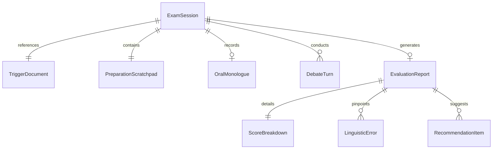
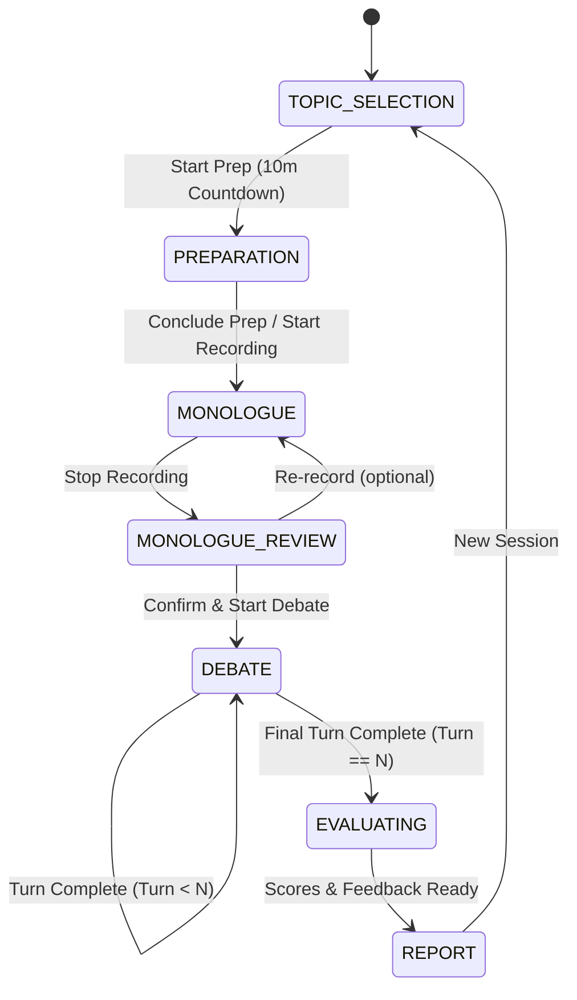

# Data Model: DELF B2 Oral Exam Simulator

**Feature**: `001-delf-b2-speaking-simulator` | **Date**: 2026-09-27

---

## 1. Entity Relationship Diagram



---

## 2. Core Entities & Field Specifications

### 2.1. `TriggerDocument` (Document Déclencheur)
Represents the authentic French prompt text used for the exam.

| Field | Type | Required | Description |
| :--- | :--- | :--- | :--- |
| `id` | `string` | Yes | Unique identifier (e.g., `"doc-teletravail-01"`) |
| `title` | `string` | Yes | Headline/Article title in French |
| `category` | `string` | Yes | Theme (e.g., `"Travail & Société"`, `"Écologie"`, `"Numérique"`) |
| `source` | `string` | Yes | Journal / publication credit (e.g., `"Le Monde, Octobre 2024"`) |
| `content` | `string` | Yes | Body text (150–250 words) |
| `problematiqueSample` | `string[]` | No | Sample candidate problem statements for guidance |
| `vocabularyLevel` | `"B2"` \| `"B2+"` | Yes | CEFR target difficulty |

### 2.2. `PreparationScratchpad`
Represents the structured notes taken during the 10-minute prep phase.

| Field | Type | Required | Description |
| :--- | :--- | :--- | :--- |
| `sessionId` | `string` | Yes | Associated exam session ID |
| `rawNotes` | `string` | Yes | Free-form candidate notes |
| `introduction` | `string` | No | Hook & Definition of the topic |
| `problematique` | `string` | No | Core research question / dilemma |
| `plan` | `string[]` | No | 2–3 structured outline parts |
| `arguments` | `string[]` | No | Bulleted arguments with examples |
| `conclusion` | `string` | No | Final stance & open perspective |
| `updatedAt` | `number` | Yes | Epoch timestamp of last update |

### 2.3. `OralMonologue` (Exposé Suivi)
Represents the candidate's initial presentation (Part 1).

| Field | Type | Required | Description |
| :--- | :--- | :--- | :--- |
| `id` | `string` | Yes | Unique monologue ID |
| `audioBlobKey` | `string` | Yes | IndexedDB storage key for audio recording |
| `audioMimeType` | `string` | Yes | e.g., `"audio/webm;codecs=opus"` |
| `durationSeconds` | `number` | Yes | Elapsed speaking time (Target: 300–420s) |
| `transcript` | `string` | Yes | Verbatim speech-to-text transcript |
| `identifiedThesis`| `string` | No | AI-extracted main argument thesis |
| `extractedArguments`| `string[]` | No | Key points detected in presentation |
| `recordedAt` | `number` | Yes | Timestamp of completion |

### 2.4. `DebateTurn` (Tour de Débat)
Represents an individual exchange in Part 2 (Debate en interaction).

| Field | Type | Required | Description |
| :--- | :--- | :--- | :--- |
| `turnIndex` | `number` | Yes | Sequence number (1 to 5) |
| `examinerQuestionText` | `string` | Yes | Spoken French question from AI Examiner |
| `examinerAudioKey` | `string` | No | Audio synthesis key or voice cache ID |
| `targetArgument` | `string` | No | The candidate assertion being challenged |
| `candidateAudioKey` | `string` | Yes | IndexedDB key for candidate's audio rebuttal |
| `candidateDurationSeconds` | `number` | Yes | Duration of candidate's reply |
| `candidateTranscript` | `string` | Yes | Verbatim candidate transcript for this turn |
| `completedAt` | `number` | Yes | Timestamp when turn was completed |

### 2.5. `EvaluationReport` (Bilan d'Évaluation DELF B2)
Represents the official diagnostic report and 25-point scoring grid.

| Field | Type | Required | Description |
| :--- | :--- | :--- | :--- |
| `id` | `string` | Yes | Unique report ID |
| `sessionId` | `string` | Yes | Reference to exam session |
| `createdAt` | `number` | Yes | Evaluation timestamp |
| `totalScore` | `number` | Yes | Total score out of 25.0 (0.0 – 25.0) |
| `isPassing` | `boolean` | Yes | `true` if $\ge 12.5$ and no eliminatory score ($< 5.0$) |
| `scoreBreakdown` | `ScoreBreakdown`| Yes | Detailed rubric subscores |
| `linguisticErrors` | `LinguisticError[]` | Yes | Detected grammar, vocabulary, or pronunciation flaws |
| `lexicalRecommendations` | `string[]` | Yes | Suggested B2/C1 connectors and idioms |
| `qualitativeSynthesis` | `QualitativeSynthesis` | Yes | Global feedback, strengths & weaknesses |

---

## 3. Supporting Sub-Schemas

### 3.1. `ScoreBreakdown`
Sub-scores adhering strictly to France Éducation international grid:

```typescript
interface ScoreBreakdown {
  monologue: {
    presentationProblematique: number; // max 3.0
    argumentationExemples: number;      // max 3.0
    coherenceOrganisation: number;     // max 3.0
    subtotal: number;                   // max 9.0
  };
  debat: {
    defensePointDeVue: number;          // max 3.0
    reactiviteInteraction: number;      // max 3.0
    subtotal: number;                   // max 6.0
  };
  linguistic: {
    lexique: number;                    // max 4.0
    morphosyntaxe: number;              // max 5.0
    phonologie: number;                 // max 1.0
    subtotal: number;                   // max 10.0
  };
}
```

### 3.2. `LinguisticError`
```typescript
interface LinguisticError {
  id: string;
  category: "morphosyntaxe" | "lexique" | "phonologie" | "connecteur";
  severity: "minor" | "moderate" | "critical";
  originalSnippet: string;       // verbatim quote from candidate transcript
  suggestedCorrection: string;   // French correction
  explanation: string;          // pedagogical rule explanation
  contextTurn: "monologue" | number; // "monologue" or turnIndex 1..5
}
```

---

## 4. Exam Session State Machine


